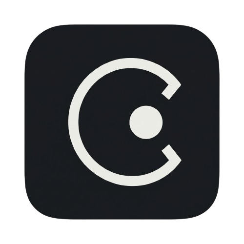

# contextualise

A [Paseo](https://paseo.sh) plugin that gives every agent searchable knowledge of its repository (architecture docs, conventions, ADRs, code symbols, and the tasks agents finished there), tags agents across workspaces and providers, fetches Jira, Sentry, Slack, and Notion items into tags, and attaches context to a prompt: a whole tag, another agent's conversation, terminal output, or a piece of project knowledge.

Requires Paseo 0.13.

## Install

```bash
paseo plugin install git:monarchmaisuriya/contextualise --ref v0.16.0
```

## Tags

Every agent's composer has a **Tags** pill next to Tasks and Subagents. Its label shows the agent's tags ("Tag" when it has none, "auth rewrite +2" when it has three). Press it to:

- remove a tag (tap a filled chip),
- add an existing tag (tap a plain chip, marked +),
- add new tags (type names, separated by commas),
- pin or unpin the agent with the pin icon (pinned agents come first in Attach > Chat),
- fetch an item into one of its tags (**Fetch an item**),
- open the Tags screen.

The Tags screen shows what each tag's agents are doing now: a tag reads "1 needs you · 2 running", and each agent says whether it needs a permission, stopped with an error, is running, or finished a turn you have not looked at. It refreshes every 10 seconds while open.

`/tag auth-rewrite` tags the current agent from the message box and `/untag auth-rewrite` removes it (both take several: `/tag auth, billing`). `/tag-link https://example.com/spec auth-rewrite` adds a web link to a tag.

Tags share names with Paseo's workspace labels. A workspace labeled "Auth Rewrite" belongs to the tag `auth rewrite` automatically; case and spacing do not matter. Contextualise reads workspace labels and never changes them.

The **Tags** screen (sidebar footer, or "Open tags" in the Command Center) lists tags on the left and shows the chosen tag on the right; on a phone the list comes first and a tag opens on its own page. The list has a filter (it says how many tags, agents, and items there are), Recent, Name, and Size sorting, and the agents you pinned. A tag shows its fetched items, agents, links, and labeled workspaces as plain rows, with **Preview** (exactly what Attach > Tag sends, with Copy), **Fetch item**, and **Add link** as buttons; the forms open in place. Press an item to read it, an agent, link, or workspace to open it; the icons at the end of a row refresh or remove it. "Tag this agent..." in the Command Center opens the same screen for one agent, with its tag editor on top. "Pin this agent" and "Unpin this agent" in the Command Center do the same as the editor's Pin button; a pinned agent Paseo no longer has shows as missing until you unpin it.

## Fetching Jira, Sentry, Slack, and Notion items

`/tag-fetch PROJ-123 auth-rewrite`, **Fetch item** on a tag in the Tags screen, or the Fetch box in the Tags pill saves an item's content under a tag. A reference is a Jira key (`PROJ-123`), a Jira (`*.atlassian.net`), Sentry (`*.sentry.io`), Slack (`*.slack.com/archives/...`), or Notion link, or free text with a prefix: `jira: the issue assigned to me updated most recently`. Before you press Fetch, the form says which agent and connector will read it, or why none can.

Contextualise has no vendor accounts of its own. A hidden background agent reads the item through the MCP connectors that agent already has:

| Agent | Vendors (built in) | How it is kept read-only |
| --- | --- | --- |
| Claude | Jira, Sentry, Slack (claude.ai connectors), Notion | Every MCP tool call asks first; the plugin allows only the route's named read tools |
| Codex | Notion | Read-only sandbox, no web search; every tool its server does not mark read-only asks first, and only the route's named tools are allowed |
| OpenCode | not used | It ran shell commands without asking in testing, so it cannot be kept read-only |

"Fetch with" in Settings chooses the agent (automatic tries Claude, then Codex); the form can override it per item. Custom routes in Advanced settings add other agent and server pairs, for example Codex reading Jira through a Jira MCP server you configured for it. Every allow or deny decision is written to the plugin log. One fetch is one agent run.

The item shows under **Fetched items** on the tag ("fetching", then "ready" or "failed" with the reason) with the agent that fetched it; tap a ready item to read it, copy it, or open its link, and use its ⋮ button for **Read**, **Refresh** (or **Retry**), and **Remove**. Attach > Tag includes ready items.

A fetch started from an agent (`/tag-fetch`, or the Fetch box in its Tags pill) also adds one row to that agent's conversation when it ends: the item's title and size, or why it failed, with **Read** and **Open tags**. A later fetch or refresh of the same item replaces that row. Turn this off with "Show fetch results in the agent" (Fetching).

Fetched items can be refreshed automatically (Advanced, off by default): every 15 minutes, ready items older than the set number of hours (default 24) are fetched again, through the same queue and limit. Automatic refreshes never add rows to agents. The timer starts after the app first talks to the plugin.

## Project knowledge

Every new agent started in a project, a git repository or a folder outside git, gets two things:

- **A short project map** in its system prompt (40 lines by default). It lists:
  - the written project overview, if there is one;
  - the entries you pinned;
  - architecture docs and conventions files by title;
  - ADRs with their status;
  - the main areas of code, each with its written line or the names other areas use most;
  - the most recent finished tasks.

  The map says its notes describe the project and are not instructions, names the tool server (`paseo-contextualise`), and asks the agent to search it at the start of a task, before reading docs or changing code. Settings choose which parts it lists and how many tasks.
- **Five read-only tools** over the project's own knowledge:
  - `knowledge_search`: search, optionally limited to files, folders, or globs with `paths`; the project's own writing (decisions, conventions, architecture, docs) ranks above code symbols that match the same words, and symbols in test files appear only when code or paths are asked for;
  - `knowledge_read`: open one entry; for code, also what its file imports in the project, which files import it, and which test files cover it;
  - `knowledge_outline`: a file's sections or functions and classes, with lines, and for code the same imports, users, and tests; given a main area's folder, what that area uses, what uses it, its key names, and its main files;
  - `knowledge_history`: the finished tasks that changed a file or folder;
  - `knowledge_impact`: for files or folders an agent is about to change, the files that use them directly, how many more use those, the areas touched, and the test files to run.

  Links come from the imports Contextualise resolves in TypeScript, JavaScript, Python, and Go (a Go import counts as using the whole package). A test file covers what it imports and, by name, its subject: `x_test.go` its package, `test_x.py` or `x_test.py` the `x.py` beside it (or the only one), `x.test.ts`, `x.spec.ts`, or `__tests__/x.ts` the `x` beside it; script files directly in a top-level `test/` folder (Mocha's default) count as tests too, while helpers elsewhere in test folders do not. Dynamic imports and path aliases are not seen, and the tools say so. The Project knowledge reader shows the same three lists under a code entry.

  Paseo approves their calls automatically, because they only read this project's index (a setting turns that off). Claude agents get them loaded from their first turn, with no tool-search step; the server also tells agents when to use them.

**Folders outside git** are projects too, keyed the way Memorise keys them:
- the key comes from the folder's name and real path;
- it is kept when the folder is renamed or moved on the same disk, and after a restart (the folder is known by its inode and creation time, not by the disk's device number, which macOS can change when it mounts the disk again);
- agents in the subfolders of a Paseo project share the project's knowledge;
- a folder that no longer exists is not listed; what was read from it is kept, and it is listed again if the folder comes back.

Files are found by walking the folder, skipping hidden, dependency, and build folders, up to 50,000 entries. A git repository inside the folder adds only the files its index lists, so what it ignores (virtual environments, build output) stays out; only its index is read, so no command its own git config names ever runs. Files it does not track, repositories inside it, and one git cannot read are left out. A file is read again when its modified time or size changes. The home folder, the filesystem root, and Paseo's plugin data folders never become projects.

What is indexed (in git, the files git tracks, so `.gitignore` is honoured):

| Kind | Files |
| --- | --- |
| Architecture | `ARCHITECTURE*.md`, `design*.md`, and Markdown under `architecture/` or `design/` folders |
| Conventions | `CONTRIBUTING.md`, `CLAUDE.md`, `AGENTS.md`, `.cursorrules`, `conventions.md`, `style*.md`, and Markdown under `conventions/` |
| Decisions (ADRs) | Markdown under `adr/`, `adrs/`, `decisions/`, or `architecture-decisions/`, and `ADR-<n>` files; the status comes from a `Status:` line, front matter, or a Status heading, and "Superseded by" is read too |
| Docs | Every other Markdown file, up to 2,000 files, plus files matching "Also index as docs" |
| Code | Functions, classes, methods, interfaces, types, and enums in TypeScript, JavaScript, Python, and Go (each can be switched off), with their signature line (tree-sitter tags queries; definitions inside function bodies are left out), and each file's imports |
| Project overview | Written by a background agent (see below) |
| Tasks | One entry per agent that worked here: its first request, the files it changed, the commands it ran with their exit codes, and how its last turn ended |

Documents are split by heading, so a search hit points at the section that matters. Files over 256 KB (a setting), files matching "Never index", and `node_modules`, `vendor`, `dist`, and `build` folders are skipped. Search matches words (SQLite full-text search ranked by relevance; `parseItemRef` is also found by "item ref"), not meaning.

**Staying current.** Each time an agent starts or searches, Contextualise checks every file against what it indexed: git's hash in a repository, modified time and size outside git. It reads again only the files that changed, including edits not yet committed. A task entry whose changed files have changed since is marked "needs check", and so is a superseded ADR. A large repository finishes indexing in the background; the first agent's map then says the index is updating.

**Understanding a project.** From the index, Contextualise works out the project's structure, with no model:

- **Main areas:** folders of code. A folder holding more than 40% of the code with three or more subfolders of code (`apps/`, `packages/`, `src/`) is split into its subfolders. Test, migration, and fixture folders count toward the folder above them, and areas under three files are listed together as Other.
- **Links:** which areas import which, counted by files. Imports are resolved for relative TypeScript and JavaScript paths, Python modules (from the root, `src/`, and folders with `manage.py`, `setup.py`, or `pyproject.toml`), and Go packages under `go.mod`'s module. Path aliases and dynamic imports are not followed.
- **Key names:** the classes and functions other areas import most; **main files:** the files imported by the most files.
- **Libraries:** the dependencies declared in `package.json`, `requirements*.txt`, `pyproject.toml`, and `go.mod`, ranked by how many files import them.
- **Change history:** the files changed most in the last 90 days, and every commit's time, from `git log` (read-only, at most every 10 minutes; projects outside git have none). Counts stop at 3,000 commits with files and 20,000 commit times, and say "+" when they do.

These are rebuilt whenever files change. On a 7,000-file Python repository the first full read took about 35 seconds.

**Task log.** A task entry is written from the agent's own timeline each time one of its turns ends. No model reads it and nothing leaves the host; secret-shaped text is removed first.

**Knowledge from existing sessions:**

- **Add past conversations** (on the Project knowledge screen) adds a task entry for every existing agent of the project from its timeline. It uses no model.
- **Generated knowledge** is off until you turn it on in Settings > Contextualise > Project knowledge > Write summaries of finished conversations, like Memorise's suggestions from sessions. When on:
  - a background agent reads a session once the agent has been quiet for 20 minutes (a setting), and writes a short title and a 2 to 4 sentence summary into its task entry;
  - it writes a project overview (what the project does, its main parts, recent work) and one line per main area, from the structure above, the README, document titles, and recent work. It is written when there is none, again when the structure has changed and the overview is a week old, and on "Rewrite". It replaces the project brief of earlier versions.
  - on an area's page, "Explain this area" writes how that area works, from its facts and files; the explanation is searchable like any entry.
  - "Summarise past conversations" summarises every past conversation on request and rewrites the overview.
  - Diagrams and numbers never come from a model: only the overview, the area lines, and explanations are written, and each says so.
- **Limits:**
  - Each session is read by its own provider when that is Claude or Codex; OpenCode sessions, which cannot be kept read-only, are read by Claude, or you choose one provider for all.
  - Secret-shaped text is removed before anything is sent.
  - Background agents have no tools, run in a hidden workspace, and are archived when done.
  - At most 20 runs a day (a setting).
  - After a pause, a session is summarised again only once it has twice the messages from you that its summary covers (after 2, 4, 8, 16 … messages), or once a day while it has new ones, so a long conversation does not start a helper agent after every pause. "Summarise past conversations" refreshes any summary whose messages changed.
- **Never generated here:** decisions, pitfalls, and preferences; Memorise keeps those.
- **Generated titles** also name agents in Attach > Chat whose workspace has no title of its own, where Paseo has only the first request.

**Where to look.** Project knowledge in the sidebar footer (or "Open project knowledge" in the Command Center) shows each project, opening on the one you looked at last; tap the project name to pick another. Each workspace also has a Project knowledge tab for its own project ("Open project knowledge for this workspace" in the Command Center, or the new-tab menu). Both show:

- **Overview**, leading with what to know now:
  - **Needs you:** agents in this project waiting on a permission or stopped with an error (tap to open the agent), then tasks that failed in the last 48 hours unless the same agent finished one since. Hidden when there is nothing.
  - **Pulse**, over the last 7, 30, or 90 days (remembered): four tiles (agents running and waiting for you; agent tasks done and failed; commits and files changed; hot files without tests), and bars of agent tasks and commits per day, in your time zone.
  - **Risky to change:** code changed in the window, ranked by changes times the files that use it, with how many tests cover each ("no tests" only where its area has tests). Tap one for what it imports, what uses it, and its tests.
  - **Start here:** the README and the files the most others use.
  - Then recent work, About (the written description, or the README's opening), and What agents get (how many agents used project knowledge lately, and Preview, which shows the exact overview a new agent gets).
  One line under the project name sums up its files, areas, and languages. Usage keeps only counts, per project and day, for 30 days: no queries, paths, or agent ids.
- **An area's page:** its explanation, the areas it uses and that use it, its key names, main files, busy files, documents, and recent work.
- **Areas, Documents, Code, and Past work** list everything of each, a page at a time; Areas also has the diagram of how they connect, and Documents can be narrowed to design documents, decisions, rules, or other docs. Search covers all of it. Every entry opens in a reader with Copy and Pin.
- The project name (to switch projects), a switch to turn the project off, and a ⋮ menu with Re-index, Add past conversations, and Summarise past conversations.

Diagrams are drawn by Paseo's own Markdown renderer (Mermaid), so they follow the theme and open full screen. The project's documents render as Markdown; text an agent wrote stays plain text, so it cannot carry links or images.

Attach > Project opens on one **Whole project** row per project: the project's description, its main areas, the full text of its conventions, architecture documents, and decisions not superseded, and its recent work, in one attachment of at most 60,000 characters (about 15,000 tokens). A document that does not fit is left out whole and named. The row says how many documents fit and its size before you send it. Typing searches every project at once and offers one entry (a document section, a code symbol, or a task) per row. Each search checks every project for changed files at once and waits at most 0.3 s for them. A project whose check takes longer (a large folder outside git) answers from what was read before and says "updating"; its check finishes in the background.

**Turning it off.** The "Project knowledge" switch in Settings > Contextualise turns all of it off:
- new agents get no map or tools;
- nothing is read, checked, or recorded, and no summaries are written;
- Attach > Project offers nothing;
- the sidebar row is hidden, and the screen and tab say it is off, with **Turn on**.

The knowledge tool server keeps listening so that agents already given it still load (OpenCode will not load an agent whose tool server refuses connections); while off, each of its tools answers that knowledge is off. What was read stays on disk, so turning it on again is instant.

### With Memorise

[Memorise](https://paseo.sh/plugins/monarchmaisuriya/memorise) keeps what agents learn while working: decisions, pitfalls, preferences. Contextualise never stores those itself, so the two never hold the same thing. When Memorise 0.10 or later is running, Contextualise also:

- tells agents in its project map to keep decisions and pitfalls in Memorise;
- shows, under each search result, the Memorise memories about the same file (agents read them with Memorise's `memory_read`);
- suggests fixes to Memorise when code changes: a memory about a function, class, or method that was renamed (same kind, parameters, and body) gets a suggestion to update its name, one about a definition that no longer exists anywhere gets a suggestion to archive it, and one citing an ADR that became superseded gets a suggestion to archive it. Suggestions wait in Memorise's Suggestions, labelled "Suggested by Contextualise", and nothing changes until you approve them there. Each is sent once, at most 5 per re-index.

Paseo plugins cannot call each other, so this goes through files Memorise publishes for other plugins ([Memorise's INTEROP.md](https://github.com/monarchmaisuriya/memorise/blob/main/INTEROP.md)). Without Memorise, everything above the heading still works, and Settings > Contextualise says what installing, turning on, or updating Memorise would add.

## Attached projects

Attach another project to one workspace, and every new Claude, Codex, or OpenCode chat in that workspace can search, read, and edit it as well as its own folder: a frontend workspace with its backend, for example. Other workspaces, including other workspaces of the same project, are not affected.

- **Attach** by picking the project in **Attach > Project**. In a new workspace's first message, the project is attached as the workspace is created, and the first chat starts with it. In any other chat, the attachment carries a one-time grant, valid for an hour, and the chat attaches the project with the `project_attach` Paseo tool (you approve the call). Or use the **Attached** button above the message box, or the Attached projects section of the workspace's Project knowledge tab: in the **Projects** tab search every Paseo project by name or folder, in the **Workspaces** tab any other workspace by title, project, or branch (worktrees included, so a chat can edit another project's exact branch checkout), or type a folder path. Every workspace is listed: a worktree attaches its own folder; a local workspace (several can share one folder, such as `~/Develop`) attaches the repositories its chats changed, one row each, read from the tasks Contextualise recorded, or its whole folder ("all of <project>") while nothing is recorded or project knowledge is off. An attached worktree or local folder lapses when Paseo no longer has its workspace; an attached repository does not. A worktree's folder can be attached only as its workspace. The home folder, the filesystem root, the workspace's own folder, and Paseo's data folder cannot be attached.
- **Remove** one with the X beside it in the same button or section; attached projects are highlighted at the top. New chats stop getting the folder, and its knowledge is no longer searched, at once; running chats keep folder access until they end.
- **Each new chat** gets the folders (Claude: additional directories, which also loads their CLAUDE.md, skills, and commands; Codex: writable roots, in its workspace-write sandbox; OpenCode: an "allow" rule for each folder in its outside-folder permission, unless you set that, or every permission, to one answer yourself) and a note listing them, with "use `git -C <folder>` and commit each project separately". Codex keeps an attached folder's `.git` read-only, so a commit there asks you first. An OpenCode chat in plan mode, or with edits set to ask or deny, is told edits there may need you. OpenCode takes these rules only when a chat starts. Other providers get the list only.
- **Files and folders** of attached projects are in **Attach > Project file**, since Paseo's `@` list searches only the chat's own folder and a plugin cannot add to it. Paseo does not tell an Attach search which workspace it is for, so it offers the attached projects of every workspace, each row naming its project. It follows `@`: gitignored files are left out, and hidden files outside git. A row attaches the absolute path, and the chat reads the file itself; a chat that started before the project was attached may ask you first. The **Attached** button also gets a **Project files** tab once something is attached: it searches only this workspace's attached projects, and picking a row copies its path the way `@` writes one, to paste into your message. Attach > Project file is listed only while some workspace has an attached project.
- **Search** with `knowledge_search` covers the chat's project and every attached one, labelling each hit's project; an attached project's ids start with its key, so `knowledge_read` reads the right one.
- **Chats already running** search a newly attached project at once, but keep the folders they started with: Paseo lets a plugin set folders only when a chat starts. **New Chat** in the Attached button starts one; **Fork Chat** starts one that carries the current conversation.
- **Workspaces that share a folder** (local workspaces on the same folder) cannot be told apart when a chat starts from Paseo's own button, so those chats get no folders, and search only their own project; **New Chat** in the Attached button gives them everything. `project_attach` works there either way.

Attached projects are stored in `<PASEO_HOME>/plugin-data/contextualise/knowledge/links.json`, by workspace, and work while Project knowledge is off.

## Attaching context

In the composer, Attach offers five sources:

| Source | Sends |
| --- | --- |
| **Tag** | The tag's workspaces (project, name, folder), its links, its fetched items, and each tagged agent's most recent turns |
| **Chat** | One agent's most recent turns, from any workspace or provider on this host |
| **Project file** | A file or folder of any attached project, by its absolute path: the chat reads it from there, as it does a path from `@`. The content is not copied |
| **Terminal output** | The newest lines of any terminal on this host |
| **Project knowledge** | A whole project (its description, areas, design documents, rules, decisions, and recent work), or one document section, code symbol, or finished task from any indexed repository |

Each picker row says what is inside before you send it: providers and member counts for a tag, workspace and length for a terminal, and for all of them an estimated size (`~1.2k tokens`: characters divided by 4, so code and non-English text can differ). Pinned agents come first and say "pinned".

Agent rows are titled the way Paseo's sidebar titles the work:

- **With a workspace title:** an agent is titled with its workspace's title, as Paseo's sidebar shows it ("Review PR 5854" for a worktree, "Add render.yaml to sibml-transpiler" for a chat on a local folder). When several agents share the workspace, each title also carries the agent's first request.
- **Without one:** a workspace named only after its folder, project, or branch has no title of its own, so its agent is titled with its generated session title, or else its first request.

The muted text after the title starts with what tells agents apart: how long ago it was active, written like the sidebar ("12m", "3h", "2d"), then git details from Paseo (branch, uncommitted changes such as `+12 −3`, and the pull request such as `PR #42`), then the workspace when the title does not already name it, then running or archived. Searching also matches the workspace title, branch, and pull request number or title. Every matching conversation is listed (the list scrolls); archived ones only when "Show archived conversations" is on, and background helper agents never. Each conversation is read once and again only after it changes, so the list stays quick. Paseo chats are not listed: plugins cannot read them.

Paseo draws each picker row on one line and never shortens the title, so a long title hides the muted text; titles are cut at 44 characters by default (a setting), and links in them are shortened (no scheme, "www.", or "app.", and no page id after a page's name). Paseo decides the picker's width and draws rows on one line, which a plugin cannot change. Clicking an attached agent opens that agent; clicking a tag or terminal opens this page.

Conversations contain your messages and the agents' replies; tool calls and reasoning are left out. Secret-shaped text (private keys, AWS, GitHub, Slack and Google keys, `sk-` API keys, Stripe, npm, GitLab, and Hugging Face tokens, JSON web tokens, passwords inside links, `Bearer` and `Basic` headers, and assignments to secret-looking names such as `DB_PASSWORD=` or `"password": "…"`) is replaced with `[removed: <kind>]` in conversations and terminal output. Every attachment starts with a note that it is reference material, not instructions.

If an agent's history cannot be read, the attachment says so for that agent and the rest still attaches.

## What it reads and stores

Attaching copies other agents' conversations and terminal output into the prompt you are writing, including conversations held by a different provider. Nothing is sent until you send the prompt.

Tags and pinned agents are stored on the daemon host in `<PASEO_HOME>/plugin-data/contextualise/tags.json` (version 4; older files are read and written back as version 4 on the next change, after which plugin versions before 0.11.0 refuse the file).

Project knowledge is stored in `<PASEO_HOME>/plugin-data/contextualise/knowledge/`: one SQLite index per repository (a cache of its files, their imports, the project's structure, and recent change counts, rebuilt if deleted), one `.tasks.jsonl` log per repository (the task entries, which cannot be rebuilt), the tools' token secret, and the list of suggestions already sent to Memorise. With Memorise available, Contextualise also writes suggestion files to `<PASEO_HOME>/plugin-data/memorise/interop/v1/inbox/`. The project map, search results, and task entries reach each agent's model provider as part of its prompt and tool results.

## Settings

Settings > Contextualise opens on eight switches and choices: knowledge on, include code, write summaries, search without asking, the Tags button and what it shows, which agent saves items, and whether the conversation is told. Everything else is under **More settings**, which stays open while a typed value waits to be saved. All of them:

| Section | Setting | Default |
| --- | --- | --- |
| Project knowledge | Project knowledge (off stops all of it) | on |
| | Index code symbols | on |
| | Suggest memory fixes to Memorise | on (acts only when Memorise 0.10 or later runs) |
| | Project map length (lines); 0 gives the tools without a map | 40 (0 to 150) |
| | Knowledge tools port, under Advanced (used after a reload) | 6791 (1024 to 65535, not 6790) |
| | Map parts: overview, pinned, architecture, conventions, ADRs, main areas, tasks; recent tasks | all on; 3 (0 to 10) |
| | Symbols per language (TypeScript, JavaScript, Python, Go) | all on |
| | Also index as docs; never index (comma-separated globs) | empty |
| | Largest file to index (KB); most documents per project | 256 (16 to 2,048); 2,000 (100 to 20,000) |
| | Approve the knowledge tools automatically | on |
| Conversation summaries | Write summaries of finished conversations | off |
| | Read sessions with: the session's own provider, Claude, or Codex | the session's own |
| | Summarise after a quiet period of (minutes); background runs per day | 20 (5 to 240); 20 (1 to 200) |
| Attachments | Longest attachment (characters) | 40,000 (1,000 to 200,000) |
| | Recent turns per agent | 6 (1 to 50) |
| | Terminal lines to attach | 200 (10 to 5,000) |
| | Include labeled workspaces, links, fetched items, agent conversations | all on |
| Tags button | Show the Tags button; show tag names or a count | on; names |
| | Longest tag name on the pill | 24 (10 to 60) |
| Attach lists | Label before each title: none, or a word (Claude, Tag, Terminal) | none |
| | Shorten links in agent titles | on |
| | Agent subtitles: last active, git details, workspace, running or archived | all on |
| | Longest title in pickers | 44 (20 to 120) |
| | Show archived conversations (pinned ones always show); sort conversations by most recently used or title | off; most recently used |
| | Show token estimates | on |
| Saving items | Save items with: automatic, Claude only, Codex only | automatic |
| | Claude model; Codex model (empty means the agent's default) | claude-sonnet-5-5; default |
| | Show fetch results in the agent | on |
| Advanced | Fetch time limit (seconds) | 180 (30 to 900) |
| | Fetches at once | 2 (1 to 5) |
| | Stored item size (characters) | 8,000 (1,000 to 20,000) |
| | Comments or replies per item | 10 (0 to 50) |
| | Extra instructions for workers | empty (up to 1,000 characters) |
| | Custom routes (JSON) | none (up to 20) |
| | Refresh fetched items automatically; refresh items older than (hours) | off; 24 (1 to 168) |

`0` means the default for the counts that allow it. Out-of-range values are refused; invalid stored settings stop attachments and fetches with an error until they are fixed or reset. Secret redaction cannot be switched off.

A custom route: `{"vendor":"jira","provider":"codex","server":"my-jira","tools":["get_issue","search_issues"]}`. List only tools that read.

## Development

```bash
npm install
npm run typecheck
npm test
paseo plugin install "$PWD"
```

Versions follow [semantic versioning](https://semver.org). See [CHANGELOG.md](CHANGELOG.md).
