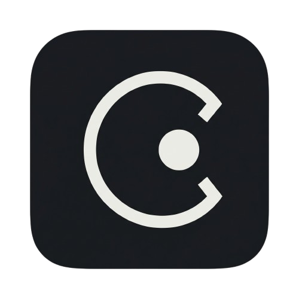

# contextualise

A [Paseo](https://paseo.sh) plugin that gives every agent searchable knowledge of its repository (architecture docs, conventions, ADRs, code symbols, and the tasks agents finished there), tags agents across workspaces and providers, fetches Jira, Sentry, Slack, and Notion items into tags, and attaches context to a prompt: a whole tag, another agent's conversation, terminal output, or a piece of project knowledge.

Requires Paseo 0.13.

## Install

```bash
paseo plugin install git:monarchmaisuriya/contextualise --ref v0.16.0
```

## Tags

Every agent's composer has a **Tags** pill next to Tasks and Subagents. Its label shows the agent's tags ("Tag" when it has none, "auth rewrite +2" when it has three). Press it to:

- remove a tag (tap a filled chip),
- add an existing tag (tap a plain chip, marked +),
- add new tags (type names, separated by commas),
- pin or unpin the agent with the pin icon (pinned agents come first in Attach > Agent conversation),
- fetch an item into one of its tags (**Fetch an item**),
- open the Tags screen.

`/tag auth-rewrite` tags the current agent from the message box and `/untag auth-rewrite` removes it (both take several: `/tag auth, billing`). `/tag-link https://example.com/spec auth-rewrite` adds a web link to a tag.

Tags share names with Paseo's workspace labels. A workspace labeled "Auth Rewrite" belongs to the tag `auth rewrite` automatically; case and spacing do not matter. Contextualise reads workspace labels and never changes them.

The **Tags** screen (sidebar footer, or "Open tags" in the Command Center) lists every tag with its labeled workspaces, tagged agents, links, and fetched items. One row at the top filters (the box says how many tags, agents, and items there are), cycles the sort (recent, name, size), and expands or collapses every tag. Each tag has **Preview**, which shows exactly what Attach > Tag sends (with a Copy button), and a ⋮ button for **Fetch item** and **Add link**. Tap an agent, link, or workspace to open it; × removes an agent or link from the tag. "Tag this agent..." in the Command Center opens it for one agent, with the same chips as the pill. "Pin this agent" and "Unpin this agent" in the Command Center do the same as the pill's Pin button; pinned agents are listed at the top of the Tags screen, where a pinned agent Paseo no longer has shows as missing until you unpin it.

## Fetching Jira, Sentry, Slack, and Notion items

`/tag-fetch PROJ-123 auth-rewrite`, **Fetch item** on a tag in the Tags screen, or the Fetch box in the Tags pill saves an item's content under a tag. A reference is a Jira key (`PROJ-123`), a Jira (`*.atlassian.net`), Sentry (`*.sentry.io`), Slack (`*.slack.com/archives/...`), or Notion link, or free text with a prefix: `jira: the issue assigned to me updated most recently`. Before you press Fetch, the form says which agent and connector will read it, or why none can.

Contextualise has no vendor accounts of its own. A hidden background agent reads the item through the MCP connectors that agent already has:

| Agent | Vendors (built in) | How it is kept read-only |
| --- | --- | --- |
| Claude | Jira, Sentry, Slack (claude.ai connectors), Notion | Every MCP tool call asks first; the plugin allows only the route's named read tools |
| Codex | Notion | Read-only sandbox, no web search; every tool its server does not mark read-only asks first, and only the route's named tools are allowed |
| OpenCode | not used | It ran shell commands without asking in testing, so it cannot be kept read-only |

"Fetch with" in Settings chooses the agent (automatic tries Claude, then Codex); the form can override it per item. Custom routes in Advanced settings add other agent and server pairs, for example Codex reading Jira through a Jira MCP server you configured for it. Every allow or deny decision is written to the plugin log. One fetch is one agent run.

The item shows under **Fetched items** on the tag ("fetching", then "ready" or "failed" with the reason) with the agent that fetched it; tap a ready item to read it, copy it, or open its link, and use its ⋮ button for **Read**, **Refresh** (or **Retry**), and **Remove**. Attach > Tag includes ready items.

A fetch started from an agent (`/tag-fetch`, or the Fetch box in its Tags pill) also adds one row to that agent's conversation when it ends: the item's title and size, or why it failed, with **Read** and **Open tags**. A later fetch or refresh of the same item replaces that row. Turn this off with "Show fetch results in the agent" (Fetching).

Fetched items can be refreshed automatically (Advanced, off by default): every 15 minutes, ready items older than the set number of hours (default 24) are fetched again, through the same queue and limit. Automatic refreshes never add rows to agents. The timer starts after the app first talks to the plugin.

## Project knowledge

Every new agent started in a project, a git repository or a folder outside git, gets two things:

- **A short project map** in its system prompt (40 lines by default). It lists:
  - the written project overview, if there is one;
  - the entries you pinned;
  - architecture docs and conventions files by title;
  - ADRs with their status;
  - the main areas of code, each with its written line or the names other areas use most;
  - the most recent finished tasks.

  The map says it describes the project and is not instructions. Settings choose which parts it lists and how many tasks.
- **Four read-only tools** over the project's own knowledge:
  - `knowledge_search`: search, optionally limited to files, folders, or globs with `paths`;
  - `knowledge_read`: open one entry;
  - `knowledge_outline`: a file's sections or functions and classes, with lines; given a main area's folder, what that area uses, what uses it, its key names, and its main files;
  - `knowledge_history`: the finished tasks that changed a file or folder.

  Paseo approves their calls automatically, because they only read this project's index (a setting turns that off).

**Folders outside git** are projects too, keyed the way Memorise keys them:
- the key comes from the folder's name and real path;
- it is kept when the folder is renamed or moved on the same disk;
- agents in the subfolders of a Paseo project share the project's knowledge.

Files are found by walking the folder, skipping hidden, dependency, and build folders, up to 50,000 entries. A file is read again when its modified time or size changes. The home folder, the filesystem root, and Paseo's plugin data folders never become projects.

What is indexed (in git, the files git tracks, so `.gitignore` is honoured):

| Kind | Files |
| --- | --- |
| Architecture | `ARCHITECTURE*.md`, `design*.md`, and Markdown under `architecture/` or `design/` folders |
| Conventions | `CONTRIBUTING.md`, `CLAUDE.md`, `AGENTS.md`, `.cursorrules`, `conventions.md`, `style*.md`, and Markdown under `conventions/` |
| Decisions (ADRs) | Markdown under `adr/`, `adrs/`, `decisions/`, or `architecture-decisions/`, and `ADR-<n>` files; the status comes from a `Status:` line, front matter, or a Status heading, and "Superseded by" is read too |
| Docs | Every other Markdown file, up to 2,000 files, plus files matching "Also index as docs" |
| Code | Functions, classes, methods, interfaces, types, and enums in TypeScript, JavaScript, Python, and Go (each can be switched off), with their signature line (tree-sitter tags queries; definitions inside function bodies are left out), and each file's imports |
| Project overview | Written by a background agent (see below) |
| Tasks | One entry per agent that worked here: its first request, the files it changed, the commands it ran with their exit codes, and how its last turn ended |

Documents are split by heading, so a search hit points at the section that matters. Files over 256 KB (a setting), files matching "Never index", and `node_modules`, `vendor`, `dist`, and `build` folders are skipped. Search matches words (SQLite full-text search ranked by relevance; `parseItemRef` is also found by "item ref"), not meaning.

**Staying current.** Each time an agent starts or searches, Contextualise checks every file against what it indexed: git's hash in a repository, modified time and size outside git. It reads again only the files that changed, including edits not yet committed. A task entry whose changed files have changed since is marked "needs check", and so is a superseded ADR. A large repository finishes indexing in the background; the first agent's map then says the index is updating.

**Understanding a project.** From the index, Contextualise works out the project's structure, with no model:

- **Main areas:** folders of code. A folder holding more than 40% of the code with three or more subfolders of code (`apps/`, `packages/`, `src/`) is split into its subfolders. Test, migration, and fixture folders count toward the folder above them, and areas under three files are listed together as Other.
- **Links:** which areas import which, counted by files. Imports are resolved for relative TypeScript and JavaScript paths, Python modules (from the root, `src/`, and folders with `manage.py`, `setup.py`, or `pyproject.toml`), and Go packages under `go.mod`'s module. Path aliases and dynamic imports are not followed.
- **Key names:** the classes and functions other areas import most; **main files:** the files imported by the most files.
- **Libraries:** the dependencies declared in `package.json`, `requirements*.txt`, `pyproject.toml`, and `go.mod`, ranked by how many files import them.
- **Busy lately:** the files changed most in the last 90 days, from `git log` (read-only, at most every 10 minutes; projects outside git have none).

These are rebuilt whenever files change. On a 7,000-file Python repository the first full read took about 35 seconds.

**Task log.** A task entry is written from the agent's own timeline each time one of its turns ends. No model reads it and nothing leaves the host; secret-shaped text is removed first.

**Knowledge from existing sessions:**

- **Add past conversations** (on the Project knowledge screen) adds a task entry for every existing agent of the project from its timeline. It uses no model.
- **Generated knowledge** is off until you turn it on in Settings > Contextualise > Conversation summaries, like Memorise's suggestions from sessions. When on:
  - a background agent reads a session once the agent has been quiet for 20 minutes (a setting), and writes a short title and a 2 to 4 sentence summary into its task entry;
  - it writes a project overview (what the project does, its main parts, recent work) and one line per main area, from the structure above, the README, document titles, and recent work. It is written when there is none, again when the structure has changed and the overview is a week old, and on "Rewrite". It replaces the project brief of earlier versions.
  - on an area's page, "Explain this area" writes how that area works, from its facts and files; the explanation is searchable like any entry.
  - "Summarise past conversations" summarises every past conversation on request and rewrites the overview.
  - Diagrams and numbers never come from a model: only the overview, the area lines, and explanations are written, and each says so.
- **Limits:**
  - Each session is read by its own provider when that is Claude or Codex; OpenCode sessions, which cannot be kept read-only, are read by Claude, or you choose one provider for all.
  - Secret-shaped text is removed before anything is sent.
  - Background agents have no tools, run in a hidden workspace, and are archived when done.
  - At most 20 runs a day (a setting).
  - A session is summarised again only after new turns.
- **Never generated here:** decisions, pitfalls, and preferences; Memorise keeps those.
- **Generated titles** also name agents in plain folders in Attach > Agent conversation, where Paseo has only the first request.

**Where to look.** Project knowledge in the sidebar footer (or "Open project knowledge" in the Command Center) shows each project:

- **Overview:** the project description (the written overview, or the README's opening), its size and languages, its most used libraries, a diagram of how the main areas connect, area cards, the files busy lately, design documents, decisions, and team rules by heading, and recent work.
- **An area's page:** its diagram of the areas it uses and that use it, its key names, main files, busy files, documents, recent work, and its explanation.
- **Areas, Documents, Code, and Past work** list everything of each, a page at a time; search covers all of it.
- A switch to turn the project off, pins (pinned entries always appear in the map), Add past conversations, Summarise past conversations, and Re-index.

Diagrams are drawn by Paseo's own Markdown renderer (Mermaid), so they follow the theme and open full screen. The project's documents render as Markdown; text an agent wrote stays plain text, so it cannot carry links or images.

Attach > Project knowledge sends one entry (a document section, a code symbol, or a task) with your prompt.

### With Memorise

[Memorise](https://paseo.sh/plugins/monarchmaisuriya/memorise) keeps what agents learn while working: decisions, pitfalls, preferences. Contextualise never stores those itself, so the two never hold the same thing. When Memorise 0.10 or later is running, Contextualise also:

- tells agents in its project map to keep decisions and pitfalls in Memorise;
- shows, under each search result, the Memorise memories about the same file (agents read them with Memorise's `memory_read`);
- suggests fixes to Memorise when code changes: a memory about a function, class, or method that was renamed (same kind, parameters, and body) gets a suggestion to update its name, one about a definition that no longer exists anywhere gets a suggestion to archive it, and one citing an ADR that became superseded gets a suggestion to archive it. Suggestions wait in Memorise's Suggestions, labelled "Suggested by Contextualise", and nothing changes until you approve them there. Each is sent once, at most 5 per re-index.

Paseo plugins cannot call each other, so this goes through files Memorise publishes for other plugins ([Memorise's INTEROP.md](https://github.com/monarchmaisuriya/memorise/blob/main/INTEROP.md)). Without Memorise, everything above the heading still works, and Settings > Contextualise says what installing, turning on, or updating Memorise would add.

## Attaching context

In the composer, Attach offers four sources:

| Source | Sends |
| --- | --- |
| **Tag** | The tag's workspaces (project, name, folder), its links, its fetched items, and each tagged agent's most recent turns |
| **Agent conversation** | One agent's most recent turns, from any workspace or provider on this host |
| **Terminal output** | The newest lines of any terminal on this host |
| **Project knowledge** | One document section, code symbol, or finished task from any indexed repository |

Each picker row says what is inside before you send it: providers and member counts for a tag, workspace and length for a terminal, and for all of them an estimated size (`~1.2k tokens`: characters divided by 4, so code and non-English text can differ). Pinned agents come first and say "pinned".

Agent rows are titled the way Paseo's sidebar titles the work:

- **In a worktree:** an agent is titled with the worktree's title ("Review PR 5854"). When several agents share the worktree, each title also carries the agent's first request.
- **Elsewhere:** in a plain folder, which collects unrelated work, an agent keeps its first request as its title, since Paseo has no other title for an agent.

The muted text after the title starts with what tells agents apart: how long ago it was active, then git details from Paseo (branch, uncommitted changes such as `+12 −3`, and the pull request such as `PR #42`), then the workspace when the title does not already name it, then running or archived. Searching also matches the workspace title, branch, and pull request number or title. Every matching conversation is listed (the list scrolls); archived ones only when "Show archived conversations" is on, and background helper agents never. Each conversation is read once and again only after it changes, so the list stays quick. Paseo chats are not listed: plugins cannot read them.

Paseo draws each picker row on one line and never shortens the title, so a long title hides the muted text; titles are cut at 44 characters by default (a setting). Paseo decides the picker's width, which a plugin cannot change. Clicking an attached agent opens that agent; clicking a tag or terminal opens this page.

Conversations contain your messages and the agents' replies; tool calls and reasoning are left out. Secret-shaped text (private keys, AWS, GitHub, Slack and Google keys, `sk-` API keys, JSON web tokens, `password=`-style assignments) is replaced with `[removed: <kind>]` in conversations and terminal output. Every attachment starts with a note that it is reference material, not instructions.

If an agent's history cannot be read, the attachment says so for that agent and the rest still attaches.

## What it reads and stores

Attaching copies other agents' conversations and terminal output into the prompt you are writing, including conversations held by a different provider. Nothing is sent until you send the prompt.

Tags and pinned agents are stored on the daemon host in `<PASEO_HOME>/plugin-data/contextualise/tags.json` (version 4; older files are read and written back as version 4 on the next change, after which plugin versions before 0.11.0 refuse the file).

Project knowledge is stored in `<PASEO_HOME>/plugin-data/contextualise/knowledge/`: one SQLite index per repository (a cache of its files, their imports, the project's structure, and recent change counts, rebuilt if deleted), one `.tasks.jsonl` log per repository (the task entries, which cannot be rebuilt), the tools' token secret, and the list of suggestions already sent to Memorise. With Memorise available, Contextualise also writes suggestion files to `<PASEO_HOME>/plugin-data/memorise/interop/v1/inbox/`. The project map, search results, and task entries reach each agent's model provider as part of its prompt and tool results.

## Settings

Settings > Contextualise:

| Section | Setting | Default |
| --- | --- | --- |
| Project knowledge | Give new agents knowledge of the project | on |
| | Index code symbols | on |
| | Suggest memory fixes to Memorise | on (acts only when Memorise 0.10 or later runs) |
| | Project map length (lines); 0 gives the tools without a map | 40 (0 to 150) |
| | Knowledge tools port (used after a reload) | 6791 (1024 to 65535, not 6790) |
| | Map parts: overview, pinned, architecture, conventions, ADRs, main areas, tasks; recent tasks | all on; 3 (0 to 10) |
| | Symbols per language (TypeScript, JavaScript, Python, Go) | all on |
| | Also index as docs; never index (comma-separated globs) | empty |
| | Largest file to index (KB); most documents per project | 256 (16 to 2,048); 2,000 (100 to 20,000) |
| | Approve the knowledge tools automatically | on |
| Conversation summaries | Write summaries of finished conversations | off |
| | Read sessions with: the session's own provider, Claude, or Codex | the session's own |
| | Summarise after a quiet period of (minutes); background runs per day | 20 (5 to 240); 20 (1 to 200) |
| Attachments | Longest attachment (characters) | 40,000 (1,000 to 200,000) |
| | Recent turns per agent | 6 (1 to 50) |
| | Terminal lines to attach | 200 (10 to 5,000) |
| | Include labeled workspaces, links, fetched items, agent conversations | all on |
| Tags button | Show the Tags button; show tag names or a count | on; names |
| | Longest tag name on the pill | 24 (10 to 60) |
| Attach lists | Label before each title: none, or a word (Claude, Tag, Terminal) | none |
| | Shorten links in agent titles | on |
| | Agent subtitles: last active, git details, workspace, running or archived | all on |
| | Longest title in pickers | 44 (20 to 120) |
| | Show archived conversations (pinned ones always show); sort conversations by most recently used or title | off; most recently used |
| | Show token estimates | on |
| Saving items | Save items with: automatic, Claude only, Codex only | automatic |
| | Claude model; Codex model (empty means the agent's default) | claude-sonnet-5-5; default |
| | Show fetch results in the agent | on |
| Advanced | Fetch time limit (seconds) | 180 (30 to 900) |
| | Fetches at once | 2 (1 to 5) |
| | Stored item size (characters) | 8,000 (1,000 to 20,000) |
| | Comments or replies per item | 10 (0 to 50) |
| | Extra instructions for workers | empty (up to 1,000 characters) |
| | Custom routes (JSON) | none (up to 20) |
| | Refresh fetched items automatically; refresh items older than (hours) | off; 24 (1 to 168) |

`0` means the default for the counts that allow it. Out-of-range values are refused; invalid stored settings stop attachments and fetches with an error until they are fixed or reset. Secret redaction cannot be switched off.

A custom route: `{"vendor":"jira","provider":"codex","server":"my-jira","tools":["get_issue","search_issues"]}`. List only tools that read.

## Development

```bash
npm install
npm run typecheck
npm test
paseo plugin install "$PWD"
```

Versions follow [semantic versioning](https://semver.org). See [CHANGELOG.md](CHANGELOG.md).
